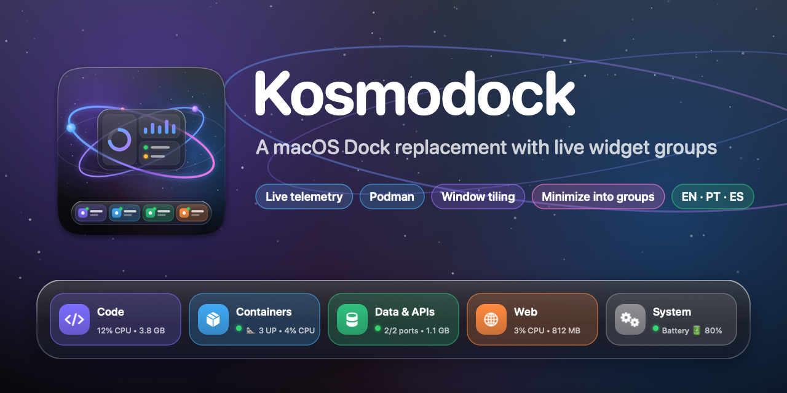

# Kosmodock

[](LICENSE)




<!-- Demo: drop a 30–60 s screen recording (or GIF) here: capsules with live telemetry, the Bento popover, Launch & Tile, a window minimizing into its group, switching languages. -->

A macOS Dock replacement built around **app groups that are live widgets**. Each capsule on the dock shows a group's apps plus live telemetry: CPU/RAM, Podman containers, listening ports, or the output of your own shell command. Clicking a capsule expands it (Bento popover or inline accordion), and one click launches the whole group and tiles its windows.

Requires macOS 14+ on Apple Silicon. Built with Swift 6.4, SwiftUI, AppKit, Mach/libproc and the Accessibility API. Free and open source under the Apache 2.0 license.

## Installation

### Download

Grab `Kosmodock-<version>.dmg` (or `.zip`) from [Releases](https://github.com/soaresnro/kosmodock/releases) and drag **Kosmodock** to `/Applications`.

Releases are signed with the **Kosmodock release certificate**, a self-signed certificate whose SHA-1 is pinned in [`.github/release-signing-certificate.sha1`](.github/release-signing-certificate.sha1). They aren't notarized by Apple yet, so Gatekeeper stops each downloaded version the first time you open it. Allow it once in **System Settings → Privacy & Security → Open Anyway**, or run `xattr -dr com.apple.quarantine /Applications/Kosmodock.app`. Every release lists its signing status and a `SHA256SUMS.txt`.

On first launch, grant **Accessibility** when macOS asks (see [Permissions](#permissions)). Updates keep the grant, because every release carries the same signing identity. The exception is 1.0.0, which was signed ad-hoc: after updating from it, grant Accessibility once more.

### Install from the terminal

```sh
curl -fsSL https://raw.githubusercontent.com/soaresnro/kosmodock/main/install.sh | bash
```

[`install.sh`](install.sh) installs the latest release in `/Applications`, quitting a running Kosmodock first:

- It downloads the release `.zip` and checks it against the release's `SHA256SUMS.txt`.
- It checks that the app is signed with the release certificate pinned at that release's tag.

Files downloaded with `curl` aren't marked as coming from the internet, so Gatekeeper doesn't stop the first launch. Running the script replaces clicking *Open Anyway* as your trust decision, so read it first if you like. Run it again to update.

To change what it does, put variables before `bash` (`curl … | KOSMODOCK_NO_OPEN=1 bash`):

- `KOSMODOCK_VERSION=1.0.1` installs that version instead of the latest.
- `KOSMODOCK_INSTALL_DIR=~/Applications` installs somewhere other than `/Applications`.
- `KOSMODOCK_NO_OPEN=1` doesn't launch it afterwards.

### Build from source

See [Build & run](#build--run) below. It takes a minute with Xcode or the Command Line Tools installed.

## Privacy

- **Nothing leaves your Mac.** Kosmodock makes no internet requests: no analytics, no update checks, no telemetry. The only sockets it opens are connections to `127.0.0.1` to check whether ports you configured are listening. Two things you add can reach the network on their own: the **GitHub** widget runs GitHub's `gh` command, which talks to GitHub with your `gh` login, and so can any shell command you configure.
- **What it reads:** CPU, memory and process usage through Mach/libproc; listening ports through `lsof`; Podman/Docker status through their CLIs (`podman machine list`, `podman ps`); and the output of shell commands **you** put in `config.json`. Widgets read only while they're on the dock:
  - **Battery:** charge, state and cycle count, through IOKit.
  - **Network:** the interfaces' byte counters through `sysctl` (totals only, no connections or traffic contents).
  - **Claude Code:** token counts and model names from Claude Code's transcripts in `~/.claude/projects` (never the messages), and the plan limits from the status data its status line saves to `~/.config/kosmodock/claude-status.json`. *Set Up* adds that status line to `~/.claude/settings.json` only when you click it, keeps a copy as `settings.json.kosmodock-backup`, and *Remove* takes it out. An existing status line is left alone.
  - **Now Playing:** the current track in Music or Spotify through AppleScript, and only while that app is already open. Its buttons play, pause and skip.
  - **Calendar:** today's and tomorrow's events, read-only, through EventKit.
  - **Reminders:** incomplete reminders from every list, through EventKit. A reminder changes only when you click its circle to complete it.
  - **Codex:** token counts, model and plan limits from OpenAI Codex's session files in `~/.codex/sessions` (and `archived_sessions`), never the messages.
  - **Now Playing** also reads the current track's album artwork from Music. Spotify keeps its app icon, since its artwork is a web URL.
- **Accessibility** is used only to move, resize, minimize, restore and raise windows, and to be notified when windows move or minimize. It reads window frames and titles (the titles are shown in *Minimized Windows*), never window contents. It also reads the macOS Dock's items for their notification badges, and, when you right-click an app, opens that app's menu in the macOS Dock for a moment to read its items.
- **Global input:** to animate minimizes and close popovers, Kosmodock observes mouse clicks system-wide and checks key presses for exactly two keys, ⌘M and Escape. Nothing is logged or stored.
- **The native Dock:** *Hide the native macOS Dock* changes four `com.apple.dock` preferences and restores your original values whenever Kosmodock quits or crashes (see [Native Dock suppression & recovery](#native-dock-suppression--recovery)). To restore them by hand: `defaults delete com.apple.dock autohide-delay; defaults write com.apple.dock autohide -bool false; killall Dock`.
- Your settings live in `~/.config/kosmodock/config.json`.

## Uninstall

1. Quit Kosmodock from its menu (this restores the native Dock).
2. Delete `Kosmodock.app` and `~/.config/kosmodock`.
3. Remove Kosmodock from **System Settings → Privacy & Security → Accessibility**, and from **Login Items** if you enabled launch at login.
4. If you built it yourself: `bash scripts/setup-signing.sh --remove` deletes the local signing identity.

## Build & run

```sh
bash scripts/setup-signing.sh   # once: stable local signing identity (see Permissions)
swift build                     # debug build (works with Command Line Tools or Xcode)
bash scripts/bundle.sh          # release build → Kosmodock.app, signed
open Kosmodock.app
```

`bundle.sh` writes an `Info.plist` with `LSUIElement` (no Dock icon), `NSAccessibilityUsageDescription` and `CFBundleIconFile`, then signs the bundle with `codesign --force --deep`. The app icon is drawn by `scripts/generate_icon.swift` (CoreGraphics; every size from 16 to 1024 px is rendered as vectors, with simplified artwork at 32 px and below) and packed with `iconutil` into `Assets/AppIcon.icns`. It is regenerated whenever the script changes; to render it by hand, run `swift scripts/generate_icon.swift Assets/AppIcon.icns preview.png`. Options:

| Variable | Default | Purpose |
| --- | --- | --- |
| `CONFIGURATION` | `release` | `debug` for a debug bundle |
| `SIGN_IDENTITY` | `Kosmodock Local Signing` if it exists, else `-` (ad-hoc) | Signing identity passed to `codesign` |
| `BUNDLE_ID` / `VERSION` | `dev.kosmodock.Kosmodock` / `1.0.0` | Bundle metadata |

Run the tests with Xcode's toolchain (the Command Line Tools don't ship XCTest):

```sh
DEVELOPER_DIR=/Applications/Xcode.app/Contents/Developer swift test
```

To get PNGs of the dock and every popover from live data (debug builds only):

```sh
swift build && .build/debug/Kosmodock --render-snapshots /tmp/kosmodock-snaps
```

### Permissions

Accessibility is the **only** permission Kosmodock needs (System Settings → Privacy & Security → Accessibility). Tiling, keeping windows above the dock, and minimize-into-group all depend on it. Kosmodock asks once at launch; the popover, Settings → Permissions and the menu also have a *Grant Access* button. Screen Recording and Input Monitoring are not used.

Three widgets ask for their own permission the first time they need it: **Now Playing** (Automation, to control Music or Spotify), **Calendar** (Calendars, read-only) and **Reminders** (Reminders). Without them, the rest of Kosmodock works as before.

macOS ties the grant to the app's code signature. An ad-hoc signature (`codesign -s -`) changes on every build, so after a rebuild the switch in System Settings still looks on but belongs to the previous build. `scripts/setup-signing.sh` creates a self-signed **Kosmodock Local Signing** certificate in your login keychain, and `bundle.sh` uses it automatically. The identity then stays the same across builds, and so does the grant. `bash scripts/setup-signing.sh --remove` deletes it. Downloaded releases use a different certificate, so macOS treats a release and your own build as different apps: switching between them means granting Accessibility again.

**Switch is on but Kosmodock still asks?** The entry belongs to an older build. Reset it and grant again:

```sh
tccutil reset Accessibility dev.kosmodock.Kosmodock
open Kosmodock.app   # asks again; switch the new entry on
```

To see what the window services are doing, read the diagnostics log:

```sh
log show --last 5m --info --predicate 'subsystem == "dev.kosmodock.Kosmodock"'
```

## Using it

- **Click a capsule** to open its Bento popover. It has a header with *Launch All* (▶) and *Launch & Tile*, tiling layout pills (`50/50 · 70/30 · 75/25 · Grid · Max`), a *Focus* toggle, the app grid with per-app RAM, and the telemetry section.
- **Right-click an app**: Focus, Hide, Tile Left/Right, Maximize, Quit, Force Quit, Show in Finder, Remove.
- **Right-click a capsule**: Launch & Tile, Launch All, Details, Layout ▸, Edit Group…
- **Accordion mode** (per group or global) expands the capsule inline, morphing mini icons into full launchers.
- **Launch & Tile** does three things. It launches any closed apps, unhides the group, and (with Focus Mode on) hides every other app. Then it waits for windows and applies the layout inside the screen's visible frame, above the dock.
- The **⊞ button** at the end of the dock, and the menu bar icon, open the Kosmodock menu: Settings, hide native Dock, Focus Mode, expansion mode, reload/open config, Quit.
- **Windows never sit behind the dock.** With *Reserve screen space* on (the default), an Accessibility observer watches every app. When a window reaches into the dock's band, it is moved up, or shrunk if it's taller than the work area. Tiling presets use the same work area. Turn the option off to get **Intellihide**: the dock slides below the screen edge while a window overlaps it, and comes back when the pointer touches the bottom edge.
- **Minimize into groups.** Minimizing a window plays a card animation from the window into its group's capsule, and the capsule bounces. The minimize can come from the yellow button, ⌘M, *Minimize to Group* in the menu, or clicking the frontmost app's icon. The capsule shows a counter, and the group's popover lists *Minimized Windows*; clicking one plays the reverse animation and restores it. Clicking an app whose windows are all minimized restores the most recent one.
- **Arrange the dock** in Settings → Dock: groups, single apps (a plain icon, like the Finder in the macOS Dock) and widgets go in any order. Drag them, or use *New Group*, *Add App* and *Add Widget* there. A single app's windows minimize into its icon.
- **Workspaces** give each thing you do its own Dock (Settings → Workspaces). Each holds its own groups, apps and widgets, and decides what happens to the other workspaces' apps when you switch: hide them (back when you return), quit them, or leave them.
  - Switch with ⌃⌥1…9, a two-finger swipe or ⌘ + scroll over the dock, the colored dots at its leading edge, or the menu.
  - A new workspace starts as a copy of the current Dock.
- **Notification badges** (unread counts and dots) show on app icons, read from the macOS Dock, which keeps running while hidden.
- **Right-click an app** to get the items it puts in its own Dock menu (New Window, its window list, bookmarks…) before Kosmodock's actions. Kosmodock reads them by opening that app's menu in the hidden macOS Dock for a moment, so the menu takes about a tenth of a second longer.
- **Widgets** are tiles on the dock, square (one reading) or wide (a reading and its details). Clicking one opens its details. Set them up in Settings → Widgets.
  - **System:** Clock (with a month calendar), Battery, CPU & Memory, Network.
  - **Apps:**
    - Claude Code: tokens, and your plan's 5-hour and weekly limits once its status line is set up.
    - Codex: tokens and plan limits, from Codex's own session files.
    - Now Playing: Music or Spotify, with controls and Music's album artwork.
    - Calendar: the next event, today and tomorrow.
    - Reminders: what's due, ticked off with a click.
    - GitHub: your open pull requests and the ones waiting for your review, through `gh`.
  - **Your own:** Command runs a shell command and shows its first line, or draws the tile from a JSON object it prints (see [Configuration](#configuration)).
- **Styles and effects** live in Settings → Appearance. Pick one of six styles (Glass, Midnight, Graphite, Neon, Paper, Floating) and fine-tune its colors, gradient angle, border, glow, corners and reflections under the icons. Each style keeps its own edits when you switch to another and back. Choose the hover effect (none, scale, or macOS-style magnification), the launch animation (bounce, pulse, shake) and the running-app indicator (dot, line or hidden, in the accent or group color).
- **Backups:** `config.json` is copied to `~/.config/kosmodock/backups/` at launch and quit (unchanged copies skipped, the 20 newest kept). Settings → Config File restores one after backing up the current config.
- The dock **adapts to screen width**. Every capsule takes the widest one's width while it fits, wide widgets turn square, and then the dock steps down from full labels to a compact layout (icons over badge), then status dots, and finally scrolls.

## Configuration

`~/.config/kosmodock/config.json` is generated on first launch by scanning `/Applications`, `/System/Applications` and `~/Applications` (including JetBrains Toolbox). The file is hot-reloaded on save. If an edit is invalid, the last good config stays active and the error shows in Settings → Config File. Every key is optional.

```jsonc
{
  "theme": {
    "style": "glass",                                  // glass|midnight|graphite|neon|paper|floating
    "surface": {                                       // the style's look; keys left out come from the style
      "blur": true, "material": "hudWindow",           // hudWindow|popover|menu|sidebar|underWindowBackground|fullScreenUI
      "fillTopHex": null, "fillBottomHex": null,       // null = the window background, following light/dark mode
      "fillOpacity": 0.35, "borderHex": "#FFFFFF", "borderOpacity": 0.6, "borderWidth": 1,
      "glowHex": "#FFFFFF", "glowOpacity": 0, "sheen": true, "cornerRadius": 22,
      "fillAngle": 0, "reflection": false              // degrees clockwise from top-to-bottom; mirror under icons
    },
    "customizations": {},                              // edits of the styles that aren't selected, by style
    "iconSize": 34, "dockMargin": 10, "tileGap": 8,
    "dockClearance": 5,                                // gap between windows and the top of the dock
    "springResponse": 0.32, "springDamping": 0.78,     // lower response = stiffer
    "accentHex": "#8B7CFF", "appearance": "system", "showGroupLabels": true,
    "hoverEffect": "scale",                            // none|scale|magnify
    "launchAnimation": "bounce",                       // none|bounce|pulse|shake
    "indicatorStyle": "dot", "indicatorColor": "accent" // dot|line|hidden, accent|group
  },
  "behavior": {
    "expansionMode": "bento", "suppressNativeDock": false, "focusMode": false, "showMenuBarIcon": true,
    "reserveScreenSpace": true,          // false = Intellihide
    "minimizeToGroups": true, "clickActiveAppToMinimize": true,
    "screenSpaceExclusions": ["com.example.SomeGame"],  // never moved/resized by the enforcer
    "showsNotificationBadges": true, "showsAppDockMenu": true
  },
  "telemetry": { "pollInterval": 3, "containerRuntime": "podman", "runtimePath": null, "fallbackToDocker": true, "commandTimeout": 10 },
  "groups": [
    {
      "id": "backend", "name": "Backend", "symbol": "server.rack", "tintHex": "#2EC27E",
      "layout": "dev70_30Stack",              // splitHorizontal50_50|dev70_30Stack|mainPlusBottom25|grid2x2|maximizeAll
      "expansionMode": "accordion",           // optional per-group override
      "apps": [
        { "name": "Rider", "path": "~/Applications/Rider.app" },
        { "name": "iTerm", "bundleId": "com.googlecode.iterm2" }
      ],
      "widget": {
        "type": "portProbe",                  // none|cpuRam|podman|portProbe|customCommand
        "ports": [5432, 6379, 8080],
        "probes": [
          { "name": "API", "command": "curl -fsS http://localhost:8080/health" },
          { "name": "Redis", "port": 6379 }
        ]
      }
    },
    {
      "name": "Deploys",
      "widget": { "type": "customCommand", "label": "CI", "interval": 30,
                  "command": "gh run list -L1 --json conclusion -q '.[0].conclusion'" }
    }
  ],
  "tiles": [
    { "kind": "clock", "width": "wide", "showsSeconds": false },
    // clock|battery|activity|network|claudeCode|codex|nowPlaying|calendar|reminders|github|command
    { "kind": "battery", "width": "square" },                       // square|wide
    { "kind": "command", "label": "Build", "command": "make -q && echo ok", "interval": 30 }
  ],
  "pinnedApps": [ { "name": "Finder", "bundleId": "com.apple.finder" } ],   // single apps, as plain icons
  "order": ["app:com.apple.finder", "backend", "tile:clock"], // group ids, app:<bundleId|path>, tile:<id>; the rest follows
  // Optional: a Dock for each thing you do. With workspaces, the active one's items replace `order`.
  "workspaces": [
    { "id": "work", "name": "Work", "colorHex": "#4C8DFF",
      "items": ["app:com.apple.finder", "backend", "tile:clock"], "otherApps": "hide" }   // keep|hide|quit
  ],
  "activeWorkspaceID": "work"
}
```

A command (in a `customCommand` group widget or a Command tile) can draw its widget by printing a JSON object instead of text. Every field is optional:

```json
{ "text": "Deploy", "detail": "2 min ago", "symbol": "cloud.fill", "color": "#2EC27E",
  "progress": 0.6, "status": "ok", "url": "https://github.com/me/app/actions" }
```

`symbol` is an SF Symbol name, `progress` goes from 0 to 1, `status` (`ok`, `warning`, `critical`) overrides the exit code, and `url` adds an *Open* button to the details.

| Widget | Capsule badge | Popover |
| --- | --- | --- |
| `cpuRam` | `12% CPU • 3.8 GB` for the group's apps and their child processes (system totals when idle) | CPU ring, memory bar, pressure |
| `podman` | `🦭 3 UP • 12% CPU` (VM process CPU) or `🦭 VM Stopped` | Machine status with Start/Stop/Initialize, container list with Start/Stop/Restart |
| `portProbe` | 🟢 all listening / 🟡 some / 🔴 none, `:5432` or `2/4 ports` | Each port with its owning process (via `lsof`) |
| `customCommand` | First line of stdout. Exit `0` = 🟢, `1` = 🟡, anything else or a timeout = 🔴 | Output, last run, *Run now* |

`probes` work with any widget type. The worst result colours the capsule's status dot. Commands run through `/bin/sh` with `PATH=/opt/homebrew/bin:/usr/local/bin:/usr/bin:/bin:…`, so Homebrew tools resolve from the GUI app. Podman is looked up at `/opt/homebrew/bin`, `/usr/local/bin` and `/opt/podman/bin`, falling back to Docker when enabled.

## Releasing

`.github/workflows/release.yml` runs on every pull request: it runs the tests and the translation check, bundles the app, and attaches `Kosmodock-<version>.dmg`/`.zip` to the workflow run. Pushing a tag publishes a release:

```sh
git tag v1.0.0 && git push origin v1.0.0
```

How the release is signed depends on the repository secrets, first match wins:

1. **Developer ID**: `MACOS_DEVELOPER_ID_P12` (base64 `.p12` with a *Developer ID Application* certificate), `MACOS_DEVELOPER_ID_P12_PASSWORD`, `MACOS_NOTARY_APPLE_ID`, `MACOS_NOTARY_TEAM_ID` and `MACOS_NOTARY_PASSWORD` (an app-specific password). The app and disk image are signed with the hardened runtime, notarized and stapled.
2. **Release certificate**: `MACOS_SELF_SIGNED_P12` and `MACOS_SELF_SIGNED_P12_PASSWORD`, created once by `bash scripts/create-release-certificate.sh`. The script also keeps the identity in your login keychain as the backup and writes its SHA-1 to `.github/release-signing-certificate.sha1`. The workflow fails if a build's signature doesn't match that file, because a new certificate would make every user grant Accessibility again. Replacing it on purpose takes `--rotate` and a commit of the new file.
3. **Neither**: an ad-hoc signature.

Moving from one to another changes the app's identity, so users grant Accessibility once more after that update. The release notes say which signing was used and how to open the app.

## Languages

The interface is available in **English (US)**, **Português (Brasil)** and **Español (España)**. Pick one in Settings → Behavior → Language, or set `"behavior": { "language": "pt-BR" }` (`system`, `en-US`, `pt-BR`, `es-ES`). The switch applies immediately to the dock, the popovers, the menus and Settings, including number formatting (`3,8 GB`). `system` follows macOS and falls back to English.

Translations live in `Localization/<lang>.lproj/Localizable.strings`, with the English text as the key, and `bundle.sh` copies them into the app. SwiftUI literals (`Text("Launch & Tile")`) are translated from the `locale` environment value; text built in code goes through `L10n.tr("…", args…)`. After adding or changing UI text, run:

```sh
python3 scripts/check_localizations.py   # every key used in code exists in every language, with matching %@/%lld
```

## Native Dock suppression & recovery

*Hide the native macOS Dock* sets `autohide` with a 1000 s `autohide-delay`. It also sets `minimize-to-application = true` and the short `mineffect = scale`, so the native minimize animation is as brief as possible. Before that, it saves the command that restores **your original** values of all four keys to `~/.config/kosmodock/.restore-native-dock.sh`. That file is run and deleted by every exit path:

- quitting normally (`applicationWillTerminate`, `NSApplication.willTerminateNotification`, `atexit`)
- `SIGINT`, `SIGTERM` and `SIGHUP` (dispatch signal sources)
- a crash, force quit or `SIGKILL`: a detached watchdog shell notices Kosmodock's pid is gone within 2 s
- the next launch, if the file is still there and suppression is off

## Architecture

```
Sources/Kosmodock
├── App/        KosmodockApp (@main), AppDelegate, AppModel (composition root, badges, actions), SnapshotRenderer (DEBUG)
├── Models/     DockConfig (lenient Codable), TelemetryModels, ContainerModels (Podman/Docker JSON parsing)
├── Services/   ConfigService + FileWatcher (hot reload), AppDiscovery, WorkspaceService,
│               SystemMetrics (Mach/libproc sampler, lsof port scanner), SystemSensors (battery, network),
│               TelemetryService,
│               ContainerMonitorService, TilingEngine (pure layout math), WindowManagerService (AX),
│               SystemDockManager, ShellRunner
├── Windowing/  FloatingPanel (non-activating NSPanel), DockController (sizing, anchoring, popovers),
│               SettingsWindowController (+ status item menu, main menu for ⌘C/⌘V)
└── Views/      DockRootView, GroupCapsuleView, BentoPopoverView, TelemetryWidgets, TileViews, AppIconView, SettingsView, Theme
```

- UI types are `@MainActor`. The package uses Swift language mode 5 so AppKit, AX and Mach interop stays free of strict-concurrency noise.
- `@State` is a SwiftUI *macro* in the macOS 27 SDK, and its plugin ships only with Xcode. Views use `@ViewState`, a thin wrapper around the `State` property-wrapper struct, so `swift build` also works with the Command Line Tools.
- Panels are sized from measured SwiftUI content. They grow immediately and shrink only after the spring settles, so expand/collapse animations are never clipped.
- AX calls run on a private serial queue, so a hung target app can't stall the 120 Hz UI. Telemetry only publishes values that changed.

## Known limitations

- macOS has no public API to redirect or cancel the WindowServer's own minimize animation. Kosmodock detects minimizes up front so its animation starts together with the system's (yellow button, ⌘M, its own clicks). Other minimizes (e.g. double-clicking a title bar) are only reported after they finish, so the card animates from the window's last frame.
- An app that maximizes itself (green button, its own tiling) briefly covers the dock before the enforcer moves it back.

- Per-app memory follows each app's process tree. XPC services launched by `launchd` (e.g. Safari's WebContent processes) aren't attributed to their app.
- Port 5000 is the macOS AirPlay Receiver by default, so a `:5000` probe reports it as listening.
- The dock lives on the primary display.

## License

Kosmodock is licensed under the [Apache License 2.0](LICENSE). You may use, modify and distribute it, including commercially, as long as you keep the license and the notices in [NOTICE](NOTICE). The license grants no rights to the Kosmodock name or icon.
